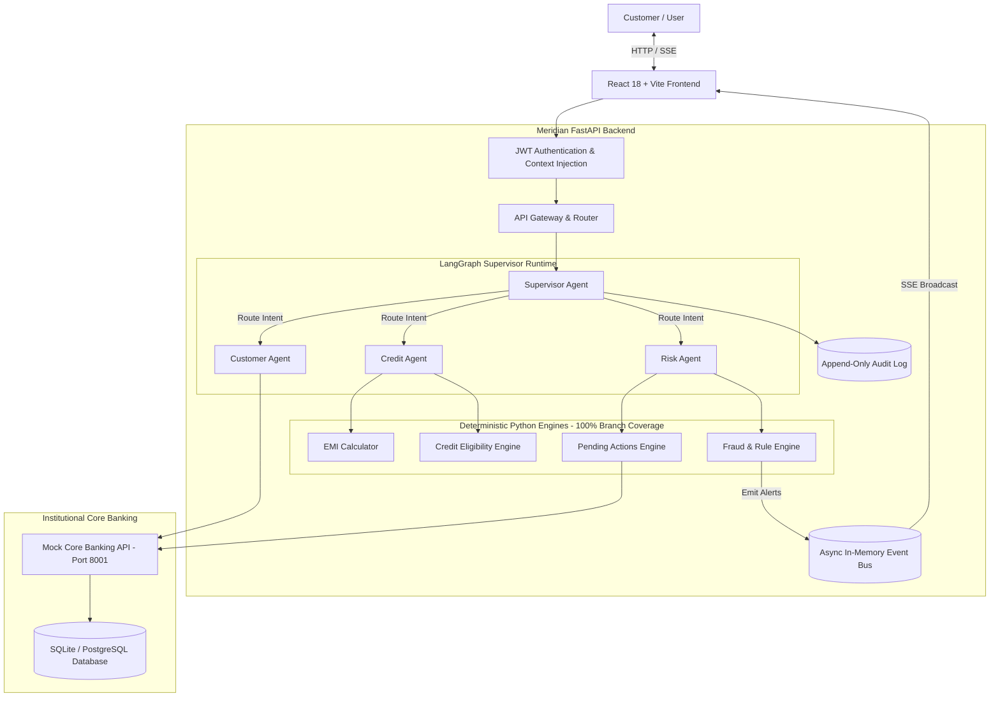
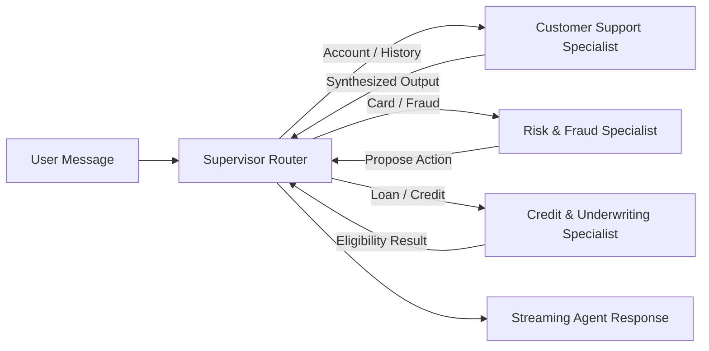
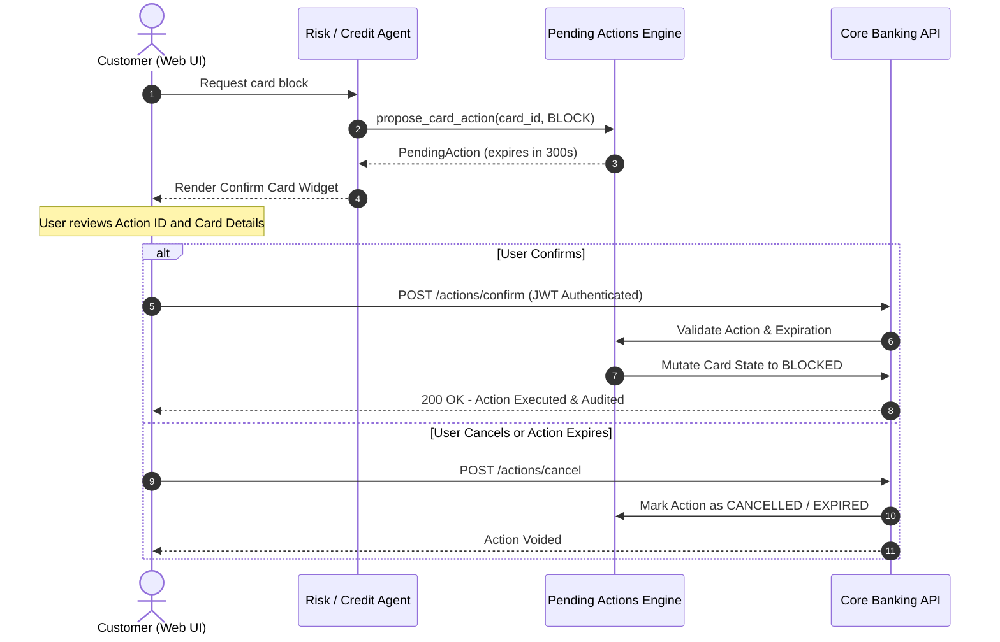

# Meridian AI Banking Agents

<p align="center">
  <strong>Enterprise-Grade, Deterministic Multi-Agent Banking Platform</strong><br>
  Built with LangGraph, Google Gemini 3.1 Pro, FastAPI, and React 18
</p>

<p align="center">
  
  
  
  
  
  
  
  
  
  
  
</p>

---

## Table of Contents
1. [Executive Overview](#executive-overview)
2. [The 10 Inviolable Engineering Tenets](#the-10-inviolable-engineering-tenets)
3. [System Architecture](#system-architecture)
4. [Autonomous Multi-Agent Hierarchy](#autonomous-multi-agent-hierarchy)
5. [Two-Phase Human-in-the-Loop Protocol](#two-phase-human-in-the-loop-protocol)
6. [Supported Personas & Test Data](#supported-personas--test-data)
7. [End-to-End Use Cases (UC1 - UC8)](#end-to-end-use-cases-uc1---uc8)
8. [Project Layout](#project-layout)
9. [Quickstart Guide](#quickstart-guide)
10. [Test & Quality Gate Verification](#test--quality-gate-verification)
11. [Configuration & Environment](#configuration--environment)
12. [Security & Compliance](#security--compliance)
13. [License](#license)

---

## Executive Overview

Modern financial applications require the conversational fluidity of Large Language Models paired with the **unyielding mathematical rigor, zero-float precision, and strict authorization boundaries** of institutional core banking.

**Meridian AI Banking Agents** bridges this gap. Meridian decouples agent orchestration from financial calculation:
- **LLMs explain, deterministic code decides.** Large Language Models interpret user queries, select specialist tools, and synthesize natural language explanations.
- **Engines execute mathematical decisions.** Balance computation, EMI amortization, credit limit risk formulas, and anomaly detection algorithms are 100% deterministic, written in pure Python using `Decimal` minor units, backed by exhaustive unit tests.
- **Human-confirmed two-phase writes.** Agents can never modify ledger state directly; they can only propose pending actions requiring cryptographic user confirmation.

---

## The 10 Inviolable Engineering Tenets

Meridian is built against the strict tenets codified in [`AGENTS.md`](./AGENTS.md):

1. **LLMs Explain; Deterministic Code Decides:** Fraud scores, loan eligibility, EMI amortization, and ledger balances come exclusively from unit-tested, deterministic Python engines. The LLM never invents or calculates numbers.
2. **Identity is Never an LLM Parameter:** `customer_id` is never passed into prompt text or tool parameters. It is verified via JWT and injected server-side into execution contexts with strict object-level authorization (OLA).
3. **Writes are Two-Phase & Human-Confirmed:** Agents may only invoke `propose_*` tools to generate a short-lived `PendingAction` (5-minute TTL). Execution occurs exclusively via `POST /actions/{id}/confirm` triggered by an authenticated human click.
4. **Money is Never a Float:** All currency calculations utilize Python `Decimal` or integer minor units (paise/cents). Amounts are serialized to JSON as strings to eliminate IEEE 754 floating-point inaccuracies.
5. **Tool Output is Untrusted Data:** All external and core-banking tool outputs are sanitized and wrapped in protective guards to prevent secondary prompt injections (e.g., malicious transaction payloads or merchant names).
6. **Every Layer Fails Safely:** Circuit breakers on the core banking client, bounded retries with jittered backoff, model fallbacks, and hard loop iteration caps (max 6 steps) ensure the agent cannot run wild or crash silently.
7. **Comprehensive Audit Trail & Observability:** Every execution step records latency, prompt version, tool call parameters (PII redacted), tokens consumed, and state transitions in an append-only audit log.
8. **Reproducible & Zero-API Dependency:** Supports `LLM_PROVIDER=mock` providing deterministic mock responses for CI, offline unit tests, and evaluations, with seamless switching to Google's official `google-genai` SDK and Gemini 3.1 Pro.
9. **Real-Time Event-Driven Architecture:** An asynchronous, thread-safe Event Bus monitors transactions in real-time, streaming Server-Sent Events (SSE) to the frontend for proactive fraud alerting.
10. **Honest UX & Financial Disclaimers:** A persistent top-level banner declares simulated environment status. Credit outputs are clearly stamped with *"Indicative, not an offer"* and balances render with locale-specific digit grouping (INR ₹).

---

## System Architecture



---

## Autonomous Multi-Agent Hierarchy

The Meridian orchestration layer is built as a compiled StateGraph in LangGraph, featuring a centralized Supervisor pattern:



- **Supervisor Agent:** Analyzes customer intent, validates authorization scope, and routes the turn to the appropriate specialist agent. Achieves **100.00% routing accuracy** in standardized benchmark evaluations.
- **Customer Support Specialist:** Handles read-only ledger queries, balance checks, transaction filtering, and account statements.
- **Risk Specialist:** Handles emergency freeze requests, card limits, dispute filings, and suspicious activity investigations. Proposes card-blocking pending actions.
- **Credit Specialist:** Orchestrates multi-step credit evaluation, calls the deterministic eligibility engine, computes EMI schedules, and synthesizes non-binding proposals.

---

## Two-Phase Human-in-the-Loop Protocol

To guarantee financial safety, Meridian separates **intent proposal** from **state mutation**:



---

## Supported Personas & Test Data

Meridian seeds deterministic customer profiles on startup:

| Persona | Name | Role / Profile | Monthly Income | Credit Score | Initial Balance | Test Scenarios |
|---|---|---|---|---|---|---|
| `arjun` | **Arjun Mehta** | Tech Worker | ₹2,50,000 | 780 (Excellent) | ₹1,45,000.00 | Account queries, card blocking (HITL), high-value credit applications. |
| `priya` | **Priya Sharma** | Small Business Owner | ₹1,80,000 | 720 (Good) | ₹3,20,500.50 | Business loan underwriting, high-velocity transactions, overseas fraud alerts. |
| `rahul` | **Rahul Verma** | University Student | ₹25,000 | 610 (Fair) | ₹4,850.00 | Low-balance warnings, overdraft protection, loan rejection explanations. |

---

## End-to-End Use Cases (UC1 - UC8)

### UC1: Transaction Intent Routing & Balance Retrieval
- **Input:** *"What is my balance and what were my last 3 transactions?"*
- **Execution:** Supervisor detects inquiry &rarr; hands off to `customer_agent` &rarr; fetches balance and transaction history &rarr; returns natural language summary with formatted INR currency.

### UC2: Agent Handoff & Human-in-the-Loop Card Blocking
- **Input:** *"I lost my card, please block it immediately."*
- **Execution:** Supervisor hands off to `risk_agent` &rarr; agent locates active card &rarr; invokes `propose_block_card` &rarr; yields a `PendingAction` widget in the UI &rarr; card remains unblocked until user presses **Confirm**.

### UC3: Multi-Step Business Loan Underwriting & EMI Math
- **Input:** *"I need a ₹50,000 loan for my business over 24 months. Am I eligible and what is my monthly EMI?"*
- **Execution:** Routed to `credit_agent` &rarr; deterministic eligibility engine evaluates DTI, credit score, and income &rarr; EMI calculation engine applies amortization math ($E = P \cdot r \cdot \frac{(1+r)^n}{(1+r)^n - 1}$) &rarr; displays indicative breakdown.

### UC4: Low-Balance Risk Guardrails
- **Input:** Tested with Rahul persona requesting a loan or transfer exceeding affordability limits.
- **Execution:** Deterministic engine rejects the proposal; agent politely explains financial health factors and alternatives.

### UC8: Real-Time Async Event Bus & Autonomous Fraud Monitor
- **Simulation:** Run `POST /simulator/inject` or click **Trigger Fraud Alert** in the UI.
- **Execution:** A high-value international transaction ($4,500 in Russia) is injected &rarr; async event bus notifies the fraud monitor &rarr; rule engine flags anomaly &rarr; real-time SSE stream alerts the UI with red banner and audio-visual cues.

---

## Project Layout

```
meridian-banking-agents/
├── .github/
│   └── workflows/
│       └── ci.yml               # GitHub Actions CI (lint, typecheck, coverage)
├── .agents/
│   └── workflows/               # Antigravity developer workflows
├── backend/
│   ├── alembic/                 # Database schema migrations
│   ├── app/
│   │   ├── api/                 # FastAPI routes (auth, chat, actions, simulator, stream)
│   │   ├── core/                # Configuration, logging, errors
│   │   ├── core_banking/        # Core banking client & standalone mock server
│   │   ├── db/                  # SQLModel schemas & async database session
│   │   ├── engines/             # Deterministic business logic (EMI, eligibility, fraud, actions)
│   │   ├── events/              # Async in-memory pub/sub Event Bus
│   │   ├── graph/               # LangGraph supervisor workflow & agent nodes
│   │   ├── llm/                 # LLM client protocols, tool registries, Gemini client
│   │   ├── simulator/           # Background transaction generator
│   │   └── main.py              # Application entrypoint & lifespan management
│   ├── scripts/
│   │   ├── eval_routing.py      # Benchmark evaluation script for supervisor routing
│   │   └── seed.py              # Deterministic database seeder
│   ├── tests/                   # Pytest suite (API, engines, graph, LLM, registry)
│   ├── Dockerfile               # Multi-stage production container
│   ├── pyproject.toml           # uv project configuration & pinned dependencies
│   └── README.md                # Backend technical guide
├── frontend/
│   ├── src/
│   │   ├── components/          # UI components (chat, dashboard, layout, blocks, inspector)
│   │   ├── context/             # AuthContext & real-time persona switcher
│   │   ├── hooks/               # React hooks for API queries & SSE streams
│   │   ├── services/            # Axios API clients
│   │   ├── types/               # TypeScript interfaces
│   │   ├── App.tsx              # Application layout root
│   │   └── main.tsx             # Entrypoint
│   ├── Dockerfile               # Production Nginx/Serve container
│   ├── package.json             # Pinned frontend dependencies
│   ├── tailwind.config.js       # Modern Tailwind theme configuration
│   └── vite.config.ts           # Vite build configuration
├── docs/
│   ├── DECISIONS.md             # Architectural Decision Records (ADR)
│   └── EVAL_REPORT.md           # Supervisor routing benchmark report (100% accuracy)
├── docker-compose.yml           # Unified multi-container orchestration
├── Makefile                     # Developer automation commands
├── AGENTS.md                    # Core project engineering rules & constraints
├── DEMO_SCRIPT.md               # Evaluator demo walkthrough script
└── README.md                    # Root project documentation
```

---

## Quickstart Guide

### Prerequisites
- **Python 3.12+** with [`uv`](https://docs.astral.sh/uv/) installed.
- **Node.js 20+** with `npm`.
- **Docker & Docker Compose** (optional, for containerized run).
- **Zero API Key Required:** Runs 100% locally and offline out-of-the-box using the deterministic Mock LLM engine (optional: `GEMINI_API_KEY` for live Google GenAI).

---

### Option A: Unified Makefile (Fastest)

```bash
# 1. Install dependencies for both backend and frontend
make setup

# 2. Seed database and launch Docker Compose
make demo
```
Open **[http://localhost:5173](http://localhost:5173)** in your browser.

---

### Option B: Local Development (Native)

#### 1. Setup & Run Backend
```bash
cd backend

# Install dependencies with uv
uv sync

# Seed deterministic personas (Arjun, Priya, Rahul)
uv run python -m scripts.seed

# Start FastAPI server
uv run uvicorn app.main:app --reload --host 0.0.0.0 --port 8000
```
Backend API will be active at **[http://localhost:8000](http://localhost:8000)** (Swagger Docs at `/docs`).

#### 2. Setup & Run Frontend
```bash
cd frontend

# Install Node dependencies
npm install

# Start Vite dev server
npm run dev
```
Open **[http://localhost:5173](http://localhost:5173)** (or `http://localhost:5174` if port 5173 is occupied).

---

### Option C: Docker Compose

```bash
# Build and run backend and frontend containers
docker-compose up --build -d

# View live logs
docker-compose logs -f
```

---

## Test & Quality Gate Verification

Meridian enforces strict continuous integration standards:

### 1. Run Complete Test Suite
```bash
# Run backend tests with coverage check (deterministic engines >= 95%)
cd backend
uv run pytest --cov=app/engines --cov-fail-under=95

# Run frontend Vitest suite
cd ../frontend
npm run test
```
*Current Status: 26 passed, 0 failed, 99.21% engine coverage.*

### 2. Linting & Formatting
```bash
# Backend Ruff
cd backend && uv run ruff check .

# Frontend ESLint
cd ../frontend && npm run lint
```
*Current Status: 0 errors across all files.*

### 3. Strict Type Checking
```bash
# Backend Mypy (Strict)
cd backend && uv run mypy --strict app/

# Frontend TypeScript Build
cd ../frontend && npm run build
```
*Current Status: 0 type issues found.*

### 4. Supervisor Routing Evaluation
```bash
cd backend
uv run python scripts/eval_routing.py
```
*Results logged to [`docs/EVAL_REPORT.md`](./docs/EVAL_REPORT.md): **10/10 correct (100.00% accuracy)**.*

---

## Configuration & Environment

Environment variables can be configured via `.env` in the project root:

| Variable | Default Value | Description |
|---|---|---|
| `LLM_PROVIDER` | `mock` | `mock` for deterministic offline testing; `gemini` for live Google GenAI. |
| `GEMINI_API_KEY` | `""` | Google GenAI API key (required if `LLM_PROVIDER=gemini`). |
| `GEMINI_MODEL` | `gemini-3.1-pro` | Model ID for supervisor and specialist reasoning. |
| `DATABASE_URL` | `sqlite+aiosqlite:///meridian.db` | Async SQLAlchemy database URI. |
| `CORE_BASE_URL` | `http://localhost:8000/mock-core/v1` | Core banking API base endpoint. |
| `JWT_SECRET_KEY` | *(32-byte secure key)* | Cryptographic key for signing customer JWT tokens. |
| `DEFAULT_CURRENCY` | `INR` | Primary currency symbol and formatting rule (`INR`, `USD`, `EUR`). |

---

## Security & Compliance

- **No Prompt-Injected Identity:** Tool schemas explicitly disallow caller identification parameters. Customer IDs are derived exclusively from verified JWT headers.
- **SQL Injection Prevention:** All database operations utilize parameterized queries through SQLModel and SQLAlchemy async sessions.
- **Secondary Prompt Injection Defense:** All dynamic text returned from tools (such as merchant descriptions) is treated as untrusted and wrapped before inclusion in LLM contexts.
- **Non-Reversible Actions:** High-risk actions require cryptographic human re-authentication and expire after 300 seconds.

---

## License

This project is licensed under the [MIT License](LICENSE) - see the LICENSE file for details.
